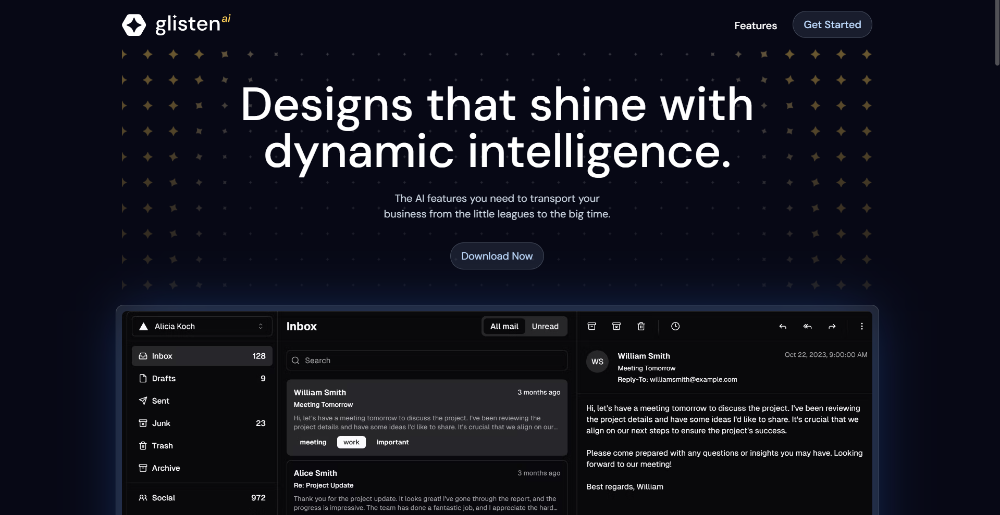

# Glisten AI - A Dark Modern Animated Website

This project is a sleek, dark, and modern website built with Next.js 16, GSAP, Tailwind, and TypeScript. It's styled in the same vein as Linear, AuthKit, Raycast, Clerk, and many more!

## Project Overview

Glisten AI started as a design exercise: a polished, animated landing page for an imaginary AI product. It's now being turned into a real product for designers and front-end developers. You'll be able to give it a screenshot or a website link and get an AI design review that pins problems right onto the image (misaligned spacing, weak contrast, confusing hierarchy) along with a score and concrete fixes. It can also generate React + Tailwind components from a description, a sketch or one of those reviews, and show them in a live preview you can keep refining by chatting.

Anyone can use it for free with their own Claude or OpenAI API key, or subscribe to a paid plan that includes hosted AI credits. The work is happening in phases. The site's content now lives in the codebase (`src/content/`) instead of a CMS. Next come the real marketing pages, then accounts, the AI features and billing.

## Tools Used

- **Next.js**: The leading React framework that enables features such as server-side rendering and generating static websites.
- **GSAP**: A robust JavaScript animation library. This project uses GSAP to add wonderful animations to the site, both on page load and on scroll.
- **Tailwind CSS**: A utility-first CSS framework. This project uses Tailwind CSS for styling.

## Usage

To run the website locally, follow these steps:

1. Clone the repository
2. Install the dependencies with `npm install`
3. Start the development server with `npm run dev`
4. Edit site copy and images in `src/content/` (no CMS needed)

## Contributing

While this is a personal group project, we are open to collaboration. If you have suggestions for improvements, please open an issue.

## License

This project is licensed under the MIT License - see the [LICENSE](LICENSE) file for details.

 
